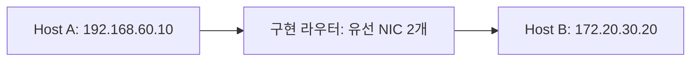

# Assignment 07 — Static Router 설계와 시연

이번 구현의 기준은 첨부한 **Computer Network Practice 10: Static Router** 및 **Practice 11: Static Router II** 자료다. `feature/assignment7-router-ui`는 Router II 23쪽처럼 라우터 전용 한 화면으로 실행한다. 기존 GARP/PARP용 Assignment 7 코드와 과제 번호가 겹치므로, 새 구현 주석은 `[assignment7][static-router]`로 구분한다. 자료의 수업 주차(10주차)와 사용자의 제출 과제 번호(07)는 다른 표기다.

## 요구사항과 구현 위치

| 자료의 요구 | 구현 |
| --- | --- |
| 26쪽: 인터페이스 IP와 Routing entry를 UI에서 직접 입력 | `StaticRouterDlg.cpp`의 내부/외부 IP/Mask/NIC 선택, `RouterDlg.cpp`의 entry 입력창 |
| 26쪽: ARP를 재사용해 next hop의 MAC 확인 | `IPRouter::Forward`, `ARPLayer::Lookup/SendRequest/Receive` |
| 26쪽: U와 UG 모두 처리 | `IPRouter::FindRoute`: G가 없으면 destination, 있으면 gateway를 next hop으로 선택 |
| 26·38쪽: 서로 다른 유선 NIC 2개 | Start가 두 NIC를 요구하며 Npcap ID 중복, Windows 인터페이스 유형/물리 NIC 여부 검사 |
| 19·20쪽: 수신 MAC/Type, 목적지 IP, 표 조회, TTL/Checksum, ARP, 출력 MAC 순서 | 기존 Ethernet/IP/ARP/Router 경로를 재사용 |
| 27쪽: 예시와 다른 사설 주소로 토폴로지 설계 | 아래 예시는 `192.168.60.0/24`와 `172.20.30.0/24` 사용. 프로그램 코드에는 고정하지 않음 |
| 34·35쪽: 라우팅 표와 수동 Add/Delete | 한 화면의 Routing/ARP/Proxy 표와 별도 entry 입력창, 인터페이스별 ARP 캐시/삭제 |
| 36·37쪽: 호스트 사이 Windows ping, 양쪽 ICMP 캡처 | 아래 실장치 절차로 최종 확인. 자동 검사는 실제 프로토콜에 ICMP 패킷을 주입하는 방식 |

## 계층 연결과 기존 기능

Port 1에는 기존 `NI → Ethernet → IP/ARP` 객체가, Port 2에는 `NI2 → Ethernet2 → IP2/ARP2` 객체가 연결된다. 두 IP 계층은 하나의 `CIPRouter`를 공유한다. 수동 라우팅 표는 이 객체가 잠금으로 보호한다. UI는 snapshot만 읽고 Npcap worker의 컨트롤 직접 접근은 없다.

`ipc2019.cpp::InitInstance`가 `CStaticRouterDlg`를 메인 Dialog로 실행한다. 채팅/파일/ARP/라우터 페이지 전환 버튼과 모드 체크박스는 새 화면에 없다. 과거 과제의 소스·리소스·주석은 보존하지만 이전 `Cipc2019Dlg`와 앱 계층은 생성하지 않는다. 이 브랜치의 실행 프로그램은 **라우터 PC 전용**이며 Host A/B는 각 Windows의 IPv4 스택과 `ping`을 사용한다.

라우터에는 서로 다른 유선 NIC 2개, Host A/B에는 각각 NIC 1개가 필요하다. 화면의 **내부 Port 1 = 내부 index 0**, **외부 Port 2 = 내부 index 1**이다. IP는 자동으로 설정하지 않으며 화면에서 입력한다. 선택 NIC의 실제 MAC은 읽기 전용으로 표시한다. 기존 프로젝트 이름과 출력 파일명 `ipc2019.exe`는 유지한다.

수동 라우팅은 항상 켜져 있다. NIC 주소에서 connected route를 자동 생성하지 않고, Proxy /32도 숨은 대체 경로로 사용하지 않는다. 표가 비어 있거나 일치하는 활성 경로가 없으면 전달하지 못한다. 라우터 자신을 대상으로 한 ping 응답은 구현 시험 대상이 아니므로 **Host A에서 Host B로 ping한다.**

화면 위쪽은 두 NIC/MAC/IP/Mask 및 `Start`/`End`, 왼쪽은 Static Routing Table, 오른쪽 위는 ARP Cache, 오른쪽 아래는 Proxy ARP Table이다. 자료의 배치를 사용하되 Mask를 직접 변경할 수 있도록 남겼다. 창 전체를 스크롤하는 방식 대신 작업 영역 안에 처음 표시하고 창 크기에 맞춰 컨트롤 크기를 조정한다. 표의 기본 스크롤과 NIC 드롭다운은 유지한다.

Proxy 표는 자료에 맞춰 표시한다. Add는 Device/IP를 받아 선택 포트의 MAC으로 대리 응답하는 항목을 등록하고 Delete는 선택한 항목을 지운다. 이 기능은 별도 Proxy 실습용이며, **일반 정적 라우팅 시연은 Proxy 표를 비워 둔다.** Proxy Add만으로 수동 Routing Table을 추가하지 않는다. 기존 Proxy 응답 기능 자체를 차단한 변경은 아니다.

`Start`는 두 포트와 표를 검증한 뒤 IP/ARP/Router를 연결하고 각각의 NI 수신 스레드를 시작한다. UI 타이머는 ARP 주소 검사·수명, IP/Router 대기 큐, 표/상태를 갱신한다. 패킷 수신 스레드는 UI 컨트롤에 직접 접근하지 않고 등록된 Windows 메시지로 알린다. `End`와 창 종료는 먼저 forwarding을 중단하고 두 worker가 끝날 때까지 기다린 뒤 주소와 캐시를 초기화한다. **End는 Proxy/ARP 캐시를 비우지만 수동 라우팅 표는 유지한다.**

## Routing entry 규칙

| 필드 | 처리 |
| --- | --- |
| Destination / Netmask | `(packet destination & mask) == entry destination`. Destination의 host bit는 0이어야 함 |
| U | 활성 경로. U가 없으면 조회에서 제외 |
| G | next hop은 Gateway IP. 출력 NIC의 subnet에서 직접 ARP 가능한 다른 호스트여야 함 |
| G 없음 | next hop은 원래 목적지 IP. Gateway 칸은 사용하지 않고 표에는 `-`로 표시 |
| H | `/32` 호스트 경로. `/32`를 입력하면 H 표시도 반영 |
| Interface | Port 1 = 내부 NIC, Port 2 = 외부 NIC. Npcap 목록의 전체 장치 번호와 다름 |
| Metric | 0~65535. prefix 길이가 같은 경로 사이에서 낮은 값 우선 |
| 기본 경로 | Destination `0.0.0.0`, Netmask `0.0.0.0`, U/G 체크, 실제 Gateway 입력 |

일치하는 행 중 가장 긴 prefix를 선택한다. 따라서 `/32` 호스트 경로, 더 구체적인 subnet, `/0` 기본 경로 순으로 우선한다. prefix와 Metric이 모두 같으면 먼저 입력한 행을 사용한다. 표의 입력 순서를 바꾸어도 기본 경로가 더 구체적인 경로를 가리지 않는다. D/M에 해당하는 ICMP Redirect 기반 경로 학습은 구현 범위에 포함하지 않는다.

표는 NIC 연결 전에도 입력할 수 있다. 연결 시 IP/Mask와 Gateway/직접 경로를 검증하며, 연결 후 추가할 때도 즉시 검증한다. 연결 해제는 수동 표를 지우지 않는다. 다음 연결에서 NIC subnet을 바꾸면 기존 표를 다시 검증한다. **프로그램을 종료하면 수동 표는 저장하지 않으므로 다시 입력한다.** 경로 삭제/추가로 출력 경로가 바뀌면 기존 ARP 대기 패킷을 폐기해 늦은 Reply로 이전 경로에 보내지 않는다.

## 패킷 전달

1. NI worker가 프레임을 복사해 Ethernet 계층에 전달한다.
2. Ethernet은 목적지 MAC과 EtherType을 검사하고 IPv4 또는 ARP로 분기한다.
3. IP는 길이와 IPv4 헤더 체크섬을 검사한다. 자기 IP 대상이면 수동 모드에서는 로컬 처리하지 않는다. 다른 호스트 대상이면 Router로 전달한다.
4. Router는 수동 표에서 경로를 선택한다. U는 목적지 IP, UG는 Gateway IP가 ARP 대상이다.
5. TTL을 1 줄이고 IP 헤더 체크섬을 다시 계산한다. IP source/destination, Protocol, ID, ICMP 본문은 유지한다.
6. MAC이 없으면 유한 큐(2 MiB, 최대 3초)에서 ARP를 기다린다. Reply 수신 후 큐를 비우고 출력 NIC로 전송한다.
7. Ethernet source는 출력 NIC의 MAC, destination은 next hop의 MAC이다. `pcap_sendpacket` 성공은 로컬 주입 성공이며 종단 호스트의 ACK가 아니다.

기존 TTL 만료의 ICMP Time Exceeded와 경로/ARP 실패의 Destination Unreachable도 재사용한다. IPv4 옵션, VLAN, NAT, 동적 라우팅, 새로 필요한 IP 단편화는 추가하지 않았다. Ethernet MTU 1500, IPv4 기본 헤더 20바이트 범위의 실습용 구현이며 RFC 라우터 전체 기능을 구현한 것은 아니다.

## Router I 시연 예시

| 장치 | IPv4 | Mask | Default Gateway |
| --- | --- | --- | --- |
| Host A | 192.168.60.10 | 255.255.255.0 | 192.168.60.1 |
| Router Port 1 / NIC 1 | 192.168.60.1 | 255.255.255.0 | 프로그램의 Routing Table 사용 |
| Router Port 2 / NIC 2 | 172.20.30.1 | 255.255.255.0 | 프로그램의 Routing Table 사용 |
| Host B | 172.20.30.20 | 255.255.255.0 | 172.20.30.1 |

두 링크는 별도의 Ethernet LAN이어야 한다. 라우터 PC에는 실제 유선 NIC 2개(예: 내장 LAN + USB Ethernet)가 필요하다. 물리 NIC만으로도 두 링크를 같은 네트워크에 연결하면 이 토폴로지가 되지 않는다.

1. Visual Studio에서 `feature/assignment7-router-ui` 브랜치로 전환하고 솔루션을 다시 빌드한다. `NPCAP_SDK_DIR`이 없으면 기존 `C:\NpcapSDK`를 사용한다. Npcap 드라이버도 설치되어 있어야 한다.
2. Host A/B의 **Windows IPv4 설정**에 위 주소, mask, gateway를 설정한다. Host A/B의 IPv4 체크는 유지한다. ICMP Echo Request를 허용하는 방화벽 규칙의 프로필과 원격 주소 범위를 실습망에 맞춘다.
3. 강의자료처럼 **라우터 PC의 두 실습용 유선 NIC에서만** TCP/IPv4 체크를 해제해 Windows IPv4 스택이 프로그램과 같은 주소에 응답하지 않게 한다. 이 조작은 프로그램에서 자동으로 하지 않는다. 실습 후 복원한다.
4. 프로그램을 실행하면 바로 `Router` 한 화면이 열린다. 위쪽에서 서로 다른 두 유선 NIC와 위 IP/Mask를 지정한다. `Port 1`이 A 쪽, `Port 2`가 B 쪽인지 확인한다.
5. 왼쪽 Routing Table의 `Add`로 아래 두 행을 **직접** 추가한다. U만 체크하고 Gateway와 H는 비워 둔다. `Start`를 누르고 주소 충돌 검사 완료 메시지를 기다린다. 라우팅 표 입력은 Start 전후 모두 가능하다. Proxy 표는 비워 둔다.

| Destination | Netmask | Gateway | Flag | Interface | Metric |
| --- | --- | --- | --- | --- | --- |
| 192.168.60.0 | 255.255.255.0 | - | U | Port 1 | 1 |
| 172.20.30.0 | 255.255.255.0 | - | U | Port 2 | 1 |

6. Host A의 command 창에서 `ping 172.20.30.20`, Host B에서 `ping 192.168.60.10`을 실행한다. ICMP에 응답하는 주체는 각 Windows 호스트다. 라우터는 Request와 Reply를 양쪽으로 전달한다.
7. 라우터의 두 NIC를 Wireshark에서 동시에 선택하고 표시 필터 `arp || icmp`를 쓴다. 최초 ping의 next-hop ARP와 Request/Reply, 캐시 Complete, 상태 영역의 전달 수 증가를 확인한다. 첫 ping만 ARP 때문에 늦을 수 있으므로 주소 검사 완료 후 여러 번 확인한다.

## Router II / UG 확인

예를 들어 Port 2 subnet에 실제 상용 라우터 `172.20.30.254`가 있고 그 너머 `10.77.0.0/24`에 시험 호스트가 있다면 다음 행을 수동으로 추가한다.

| Destination | Netmask | Gateway | Flag | Interface | Metric |
| --- | --- | --- | --- | --- | --- |
| 10.77.0.0 | 255.255.255.0 | 172.20.30.254 | UG | Port 2 | 1 |

이때 ARP 대상은 `10.77.0.x`가 아니라 `172.20.30.254`다. 상용 라우터 쪽에도 `192.168.60.0/24`로 돌아오는 경로(next hop `172.20.30.1`)가 필요하다. 표에 UG 행을 추가하는 것만으로 상용 라우터나 원격 호스트가 생성되는 것은 아니다. 현장에서 지정받는 실제 주소로 입력값을 바꾸어 사용한다.

## 보고서 사진

- UI: 연결된 두 NIC/IP/Mask, 수동 입력한 Routing Table, Port별 ARP 캐시가 함께 보이는 화면.
- 코드: `IPRouter::FindRoute`의 longest-prefix/Metric/next-hop 선택, `Forward`의 TTL/Checksum/ARP 대기/송신, `StaticRouterDlg`의 두 NIC 시작/종료 및 세 표 연결, `RouterDlg`의 entry 입력.
- 실행: Host A/B의 실제 ping 결과.
- 패킷: **라우터 양쪽 인터페이스의 ICMP Echo Request/Reply**. 같은 Identifier/Sequence와 출발지·목적지 IP를 연결해 설명한다. Request는 A→Router와 Router→B, Reply는 B→Router와 Router→A를 대조한다. TTL 1 감소, Ethernet 주소 교체, ICMP 본문 유지가 관찰되어야 한다. 실제 Windows 버전의 최초 TTL은 캡처값으로 적는다.

보고서에는 토폴로지, 장비별 IP/Mask/Gateway, 수동 표와 그 구성 이유, 구현 함수와 동작 단계의 대응을 포함한다. 제출 실행 파일은 Windows에서 최신 소스로 빌드한 결과를 사용한다.

## 검증과 한계

- `python tests/run_protocol_tests.py`: 실제 프로토콜 소스를 ASan/UBSan으로 컴파일하고 U/UG/H/기본 경로, LPM/Metric, 비활성 경로, 잘못된 입력, 양방향 ICMP, gateway ARP, 대기 중 경로 삭제와 늦은 Reply, 재연결 표 검증을 실행한다. 기존 ARP/GARP/PARP/채팅/파일 회귀 검사도 포함한다.
- `python tests/check_project_integration.py`: 프로젝트/filters 등록, 메인 진입점 교체, 리소스 ID/화면 범위, 컨트롤 연결, 두 NIC/타이머 정리 및 원래 과제 4 주석 보존을 검사한다.
- `python tests/run_dialog_scroll_tests.py`: 기존 스크롤 계산과 선언/구문을 검사한다.
- `python tests/run_router_ui_syntax.py`: RouterDlg와 StaticRouterDlg의 실제 선언/구현을 최소 MFC 선언 대체물로 컴파일해 타입/호출 구문을 검사한다. 실제 Windows/MFC 빌드는 아니다.

이 환경에서 실제 Windows/MFC 빌드, 물리 유선 NIC 2개를 통한 Npcap 전달, 실제 Windows `ping`과 Wireshark 화면은 실행하지 않았다. 위 절차로 실습 장치에서 최종 확인해야 한다.

참고: 강의자료의 26–27, 34–38쪽 및 [RFC 1812](https://www.rfc-editor.org/rfc/rfc1812.html)의 IPv4 forwarding/longest-prefix/TTL 규칙.
